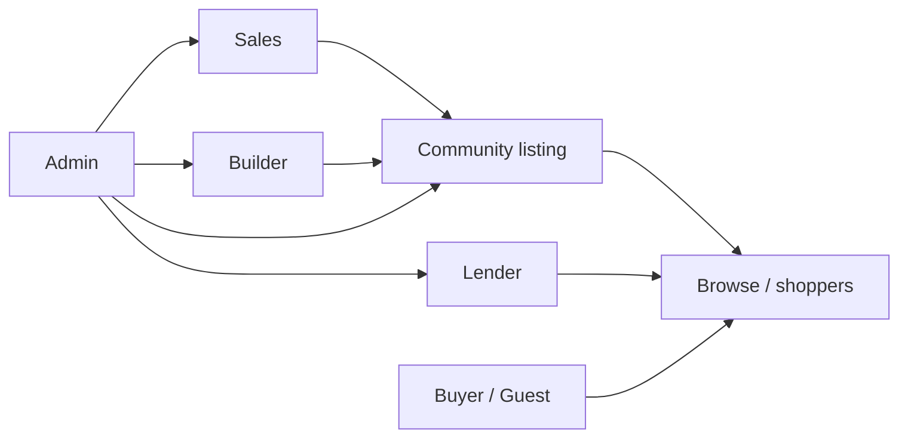
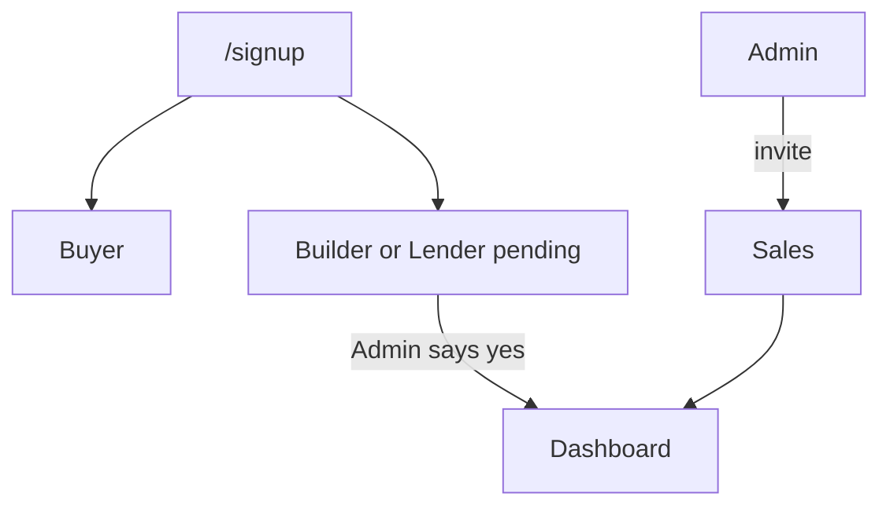
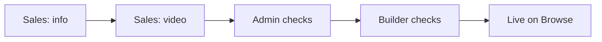

# How roles connect

**Short version:** Admin unlocks people. Sales + Builder (with Admin) put listings live. Lenders add financing. Buyers browse.

Per-role detail: [Buyer](./buyer.md) · [Builder](./builder.md) · [Lender](./lender.md) · [Sales](./sales.md) · [Admin](./admin.md)

---

## The map

| Group | Roles | Job |
|-------|--------|-----|
| Shoppers | Guest, Buyer | Look at homes |
| Partners | Builder, Lender | Supply listings / financing |
| Internal | Sales, Admin | Create, approve, go live |

---

## Getting an account

1. **Buyer** — signs up → uses the app right away  
2. **Builder / Lender** — sign up → wait for Admin  
3. **Sales** — only Admin can invite them  
4. **Admin** — set once in the database (see [admin.md](./admin.md))  
5. **`/partner`** — sales lead only; does **not** create a login

---

## How a listing goes live

That’s the chain: **Sales → Admin → Builder → Browse**.

Builders can also add their own communities. Same idea: nothing public until it’s live.

**Admin assignment:** On a community, Admin can pick **Assigned sales** and **builder org(s)**. On a builder org, Admin can pick **Account owner** (builder login). That is how existing listings get into a sales or builder dashboard.

---

## Who touches the shopper

| Who | What shoppers see |
|-----|-------------------|
| Builder | Communities, homes, videos, logos |
| Sales | Same, after the listing is live |
| Lender | Financing offers on a community page |
| Admin | What shows on the homepage (Featured, Top 10, …) |
| Buyer | All of the above (saves stay on this device for now) |

Shoppers are **not** in the approval chain. They only browse.

---

## Who is in charge of what

- **Only Admin** — approve Builder/Lender accounts, invite Sales, edit homepage, full catalog, assign communities to sales/builders  
- **Sales** — draft listing + video, submit for review (also receive admin-assigned listings)  
- **Builder** — final yes/no before live (on sales handoffs); manage own listings (needs Account owner set)  
- **Lender** — own profile and offers only  
- **Buyer** — no dashboard  

---

## Not built yet (cross-role)

- `/partner` should be able to create a pending Builder account  
- Buyer saves should sync to the cloud  
- Browse should show real lenders, not just a contact email  
- Sales and Admin should share clearer pipeline status  

---

[← All handbooks](./README.md)
